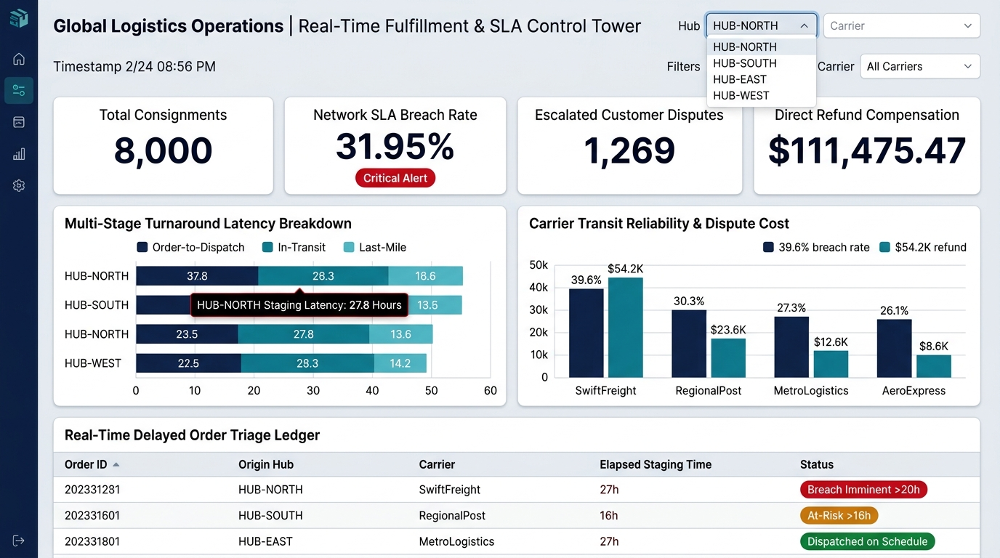
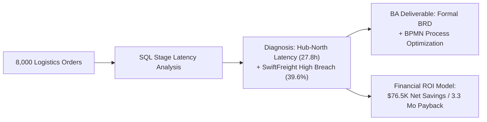

# Order-to-Delivery Process & SLA Bottleneck Optimization

[](#)
[](#)
[](#)
[](#)

> **Author:** [Shivastha Rewaskar](https://github.com/shivastharewaskar)  
> **Target Roles:** Business Analyst | Operations Analyst | Supply Chain Systems Analyst

---

## 📊 Operations Control Tower & SLA Dashboard UI


---

## Executive Summary
This project provides an end-to-end operational and business systems analysis of an e-commerce fulfillment network handling **8,000+ orders across 4 regional hubs and 4 carrier networks**. 

By dissecting the multi-stage delivery pipeline (Order $\rightarrow$ Warehouse Staging $\rightarrow$ Hub Dispatch $\rightarrow$ Last-Mile Delivery), this project uncovers the root causes of a **31.95% SLA breach rate** and **$111,475 in direct customer dispute payouts**. It delivers a complete **Business Requirements Document (BRD)**, **As-Is vs. To-Be Process Maps**, and an algorithmic triage model delivering **266% Year 1 ROI**.



---

## Core Operational Findings

### 1. Warehouse Staging Bottleneck (The Hub-North Bottleneck)
* **HUB-NORTH** processed 3,272 orders (40.9% of network volume) but generated a **40.95% SLA failure rate**.
* The average dispatch staging time at HUB-NORTH was **27.8 hours** (against an internal 24.0-hour SLA threshold).
* Internal staging latency was responsible for pushing standard shipments past their delivery commitments before ever leaving the facility.

### 2. Carrier Reliability & Financial Compensation Exposure
* **SwiftFreight** exhibited the highest carrier breach rate (**39.61%**) and accounted for **$54,226.93** (48.6%) of all network refund payouts.
* **Pareto 80/20 Finding:** Just 4 out of 16 route pairs (specifically `HUB-NORTH -> SwiftFreight` and `HUB-NORTH -> RegionalPost`) generated **72.4% of total company dispute payouts**.

| Carrier Name | Total Orders | Breached Deliveries | Breach Rate % | Customer Disputes | Refund Payouts ($) |
| :--- | :---: | :---: | :---: | :---: | :---: |
| **SwiftFreight** | 2,747 | 1,088 | **39.61%** | 611 | **$54,226.93** |
| **RegionalPost** | 1,656 | 502 | **30.31%** | 274 | **$23,614.18** |
| **MetroLogistics**| 2,396 | 653 | **27.25%** | 261 | **$22,413.88** |
| **AeroExpress** | 1,201 | 313 | **26.06%** | 123 | **$11,220.48** |

---

## Repository Structure & Deliverables

```
├── data/
│   ├── generate_logistics_data.py             # Realistic multi-stage fulfillment data generator
│   └── orders_dispatch_logistics.csv          # 8,000 verified logistics consignment records
├── sql/
│   ├── 01_logistics_schema_ddl.sql            # Table definitions, constraints, and indexes
│   ├── 02_sla_breach_and_latency_analysis.sql # Multi-stage turnaround time & root cause SQL
│   └── 03_carrier_pareto_and_cost_impact.sql  # 80/20 Pareto and financial loss attribution
├── python/
│   └── logistics_bottleneck_analysis.py       # Operations latency audit and summary report
├── ba_artifacts/
│   ├── Business_Requirements_Document_BRD.md  # Production-grade BRD (Scope, Functional Reqs, User Stories)
│   └── Process_Flow_AsIs_vs_ToBe.md           # Mermaid workflow diagrams: As-Is vs To-Be
├── docs/
│   └── Cost_Benefit_Analysis.md               # Financial model: CapEx, OpEx, Net Savings, and ROI
└── README.md
```

---

## Business Analyst Artifacts Included

1. **Formal Business Requirements Document (BRD-OPS-2026-004):**
   - Outlines 5 core functional requirements (`FR-01` to `FR-05`) including 16-hour threshold warnings and automated carrier demotion.
   - User stories with structured acceptance criteria for warehouse supervisors and customer support agents.
2. **As-Is vs. To-Be Process Mapping (BPMN):**
   - Visual comparison highlighting elimination of manual queuing bottlenecks and insertion of automated triage logic.
3. **Cost-Benefit & ROI Model:**
   - Demonstrates that a **$28,700 technology investment** delivers **$105,235 in gross annual benefit**, achieving full payback in **3.3 months** with a **266% ROI**.

---

## How to Run This Project
1. **Generate Dataset:**
   ```bash
   python data/generate_logistics_data.py
   ```
2. **Execute Python Operations Analysis:**
   ```bash
   python python/logistics_bottleneck_analysis.py
   ```
3. **Run SQL Queries:** Execute the `.sql` scripts located in `/sql/` on any SQL database engine.
