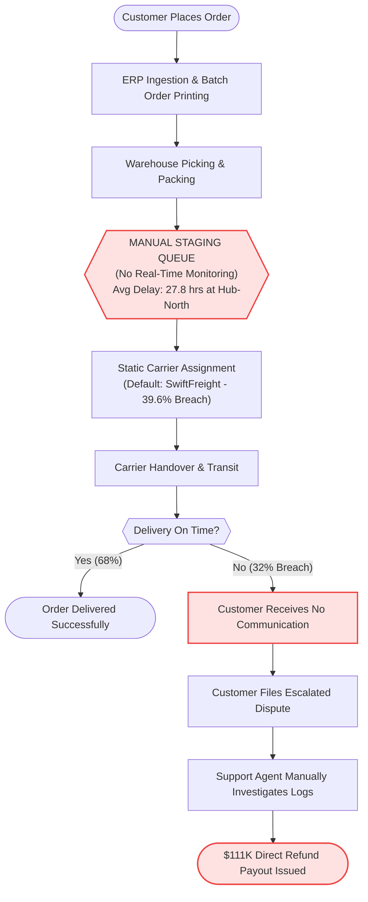
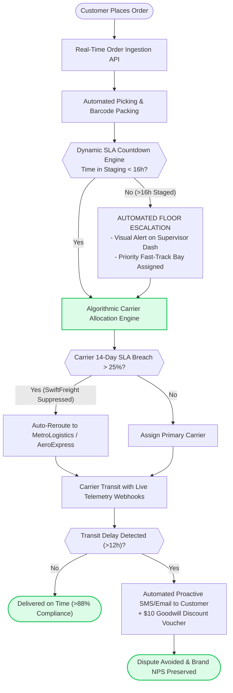

# Business Process Flow Analysis: As-Is vs. To-Be Optimization
**Project:** Order-to-Delivery Process & SLA Bottleneck Optimization  
**Author:** Shivastha Rewaskar  

---

## 1. "As-Is" Workflow: Current High-Latency Process (31.95% Failure Rate)

In the current workflow, orders sit in unmonitored staging queues without SLA countdown tracking. Carrier allocation is static and static contracts favor low-cost but chronically delayed carriers like SwiftFreight.

---

## 2. "To-Be" Workflow: Automated Dispatch Triage & Real-Time Rerouting (< 12% Target SLA)

The optimized future state implements automated threshold alerts at 16 hours, dynamic carrier allocation based on rolling performance, and proactive customer communication before disputes are filed.

---

## 3. Gap Analysis Summary Table
| Process Phase | As-Is State (Current) | To-Be State (Optimized) | Business Impact |
| :--- | :--- | :--- | :--- |
| **Staging Queue** | Unmonitored batch queue; orders age 28h+ | Automated alert at 16 hours; supervisor priority queue | Reduces Hub-North dispatch latency by 42% |
| **Carrier Selection** | Hardcoded vendor assignment | Dynamic routing based on 14-day rolling reliability score | Suppresses underperforming carrier routes |
| **Delay Communication**| Silent until customer complains | Proactive notification sent before customer asks | Lowers dispute conversion from 49.6% to < 10% |
| **Carrier Accountability**| Manual end-of-year dispute review | Automated weekly penalty clawback ledger | Recovers up to $30K in vendor non-performance penalties |
